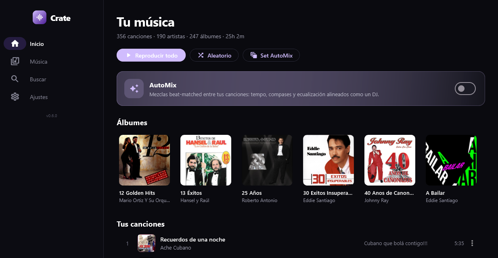
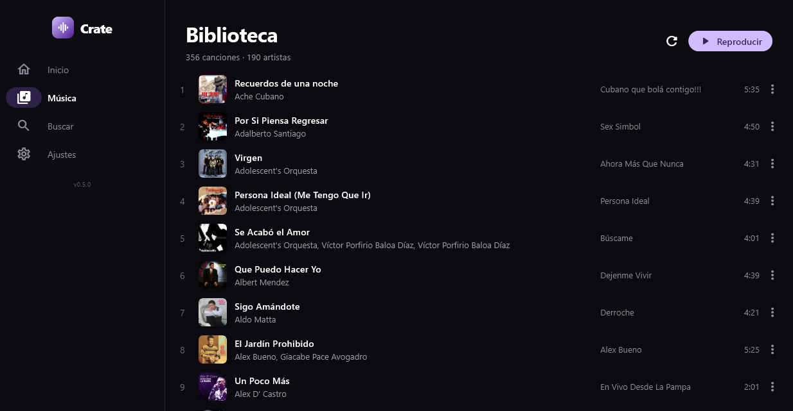
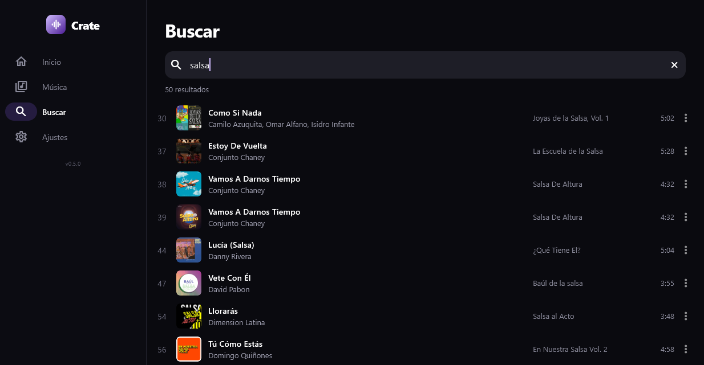
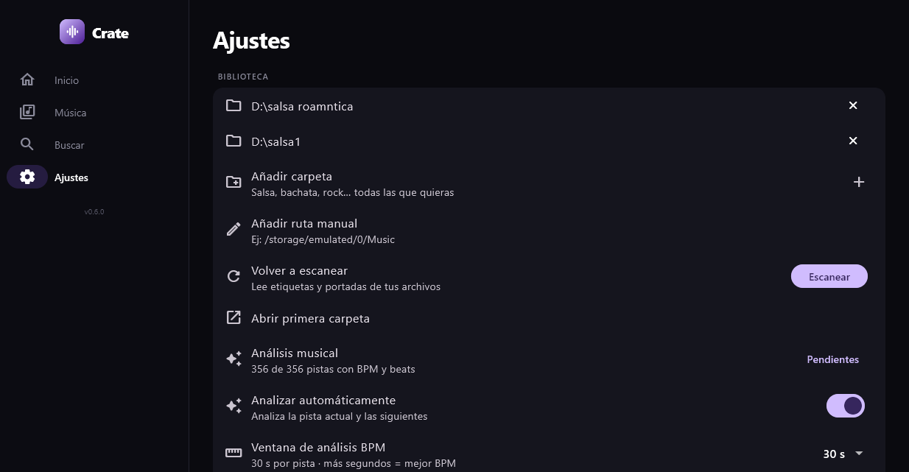
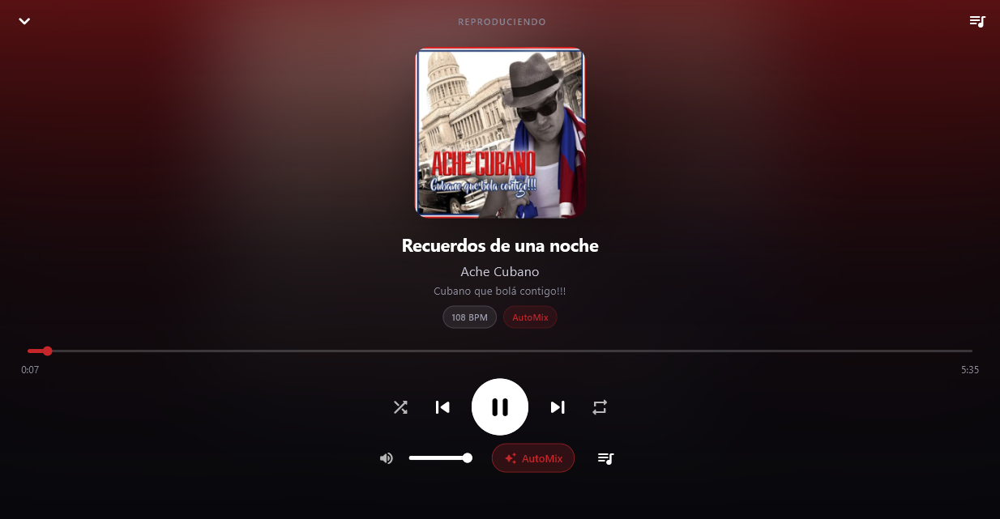

# Crate

**Reproductor de música local con AutoMix para Windows y Android.**


[](https://github.com/crdacoga2016-beep/crate/releases/latest)

Crate es un reproductor **100 % local**: no hay streaming, cuentas ni telemetría.
Lee tu biblioteca de música, la analiza en el dispositivo y mezcla las canciones
con transiciones beat-matched cuando hay análisis disponible.



## Características

- **Biblioteca multi-carpeta** con escaneo, metadatos y portadas.
- **Cola de reproducción**, búsqueda por título/artista/álbum, aleatorio y
  Smart Shuffle opcional.
- **AutoMix de 2 decks** con `media_kit` / `libmpv`:
  - detección de BPM, beats y downbeats;
  - tempo match preservando el tono;
  - alineación de fase por downbeat;
  - crossfade configurable, EQ y bass swap;
  - normalización de volumen, preamp y graves/agudos;
  - fallback a crossfade con EQ si falta análisis.
- **Análisis en el dispositivo**:
  - Android: decodificación con `MediaCodec` y DSP nativa en Kotlin
    (FFT + autocorrelación + RMS + downbeats).
  - Windows: `ffmpeg` + DSP en Dart dentro de un isolate.
  - **Ventana de BPM configurable**: 30 s por defecto; 60/90/120 s y canción
    completa en Windows para bibliotecas más exigentes.
  - Importación del `analysis.json` generado en el PC.
- **Notificación y pantalla bloqueada en Android** mediante un servicio en
  primer plano con `MediaSessionCompat` nativo (play/pausa/anterior/siguiente/
  stop, seek y portada).
- **UI responsive** para escritorio y móvil: Inicio, Biblioteca, Buscar,
  Reproduciendo, Cola y Ajustes.
- Todo el procesamiento y la reproducción ocurren en tu equipo.

## Capturas

| Inicio | Biblioteca |
| --- | --- |
|  |  |

| Buscar | Ajustes |
| --- | --- |
|  |  |

| Reproduciendo |
| --- |
|  |

## Cómo funciona el AutoMix

1. **Análisis**: de cada pista se obtienen BPM, beats/downbeats, `leadIn`,
   `audibleEnd`, puntos de entrada/salida (`mixIn`/`mixOut`), energía y
   features de timbre. La ventana de BPM es configurable (30 s por defecto,
   hasta la canción completa en Windows). La tonalidad se descartó a propósito
   para que funcione con bibliotecas multi-género sin depender de tags poco
   fiables.
2. **Selección**: el estilo de transición se decide con **tempo y energía**
   (o se fuerza manualmente desde Ajustes).
3. **Mezcla**: se precarga el siguiente deck, se ajusta el tempo con `setRate`
   (sin cambiar el tono), se alinea la fase al downbeat, se hace el crossfade
   con curva de ganancia y EQ/bass swap, y se vuelve suavemente a `rate = 1`.
4. **Fallback**: si no hay análisis o la pista no es compatible, se hace un
   crossfade con EQ; el silencio entre pistas se gestiona con los puntos
   `leadIn`/`audibleEnd`.

## Arquitectura

```text
Flutter (Dart)
├── AppState            biblioteca, cola, AutoMix, ajustes, notificación
├── PlayerService       2 decks media_kit/libmpv, crossfade, EQ, preamp
├── DeviceAnalyzer      análisis en Android (nativo) o Windows (ffmpeg + Dart)
└── MediaNotification   puente del canal crate/media

Android (Kotlin)
├── MainActivity        canales crate/permissions, crate/media, crate/analysis
├── CrateMediaService   foreground service + MediaSessionCompat + notificación
└── NativeAnalyzer      MediaCodec + FFT + autocorrelación en Kotlin

Windows
└── crate.exe + ffmpeg.exe (análisis)
```

## Estructura del proyecto

```text
lib/
  main.dart
  app.dart
  models/               Track, TrackAnalysis
  services/             player, biblioteca, analizador, notificación
  state/                AppState (punto central)
  ui/                   pantallas, reproductor, widgets
  theme/
android/
  app/src/main/kotlin/  MainActivity, CrateMediaService, NativeAnalyzer
tools/
  analyze.py            analizador opcional con librosa para PC
windows/                runner de Flutter
docs/screenshots/       capturas para el README
```

## Requisitos

- Flutter 3.47+ / Dart 3.13+.
- Windows 10/11 (para el build de escritorio).
- Android SDK 24+ / JDK 17 (para el APK).
- `ffmpeg.exe` para el análisis local en Windows. Descárgalo (build essentials)
  y colócalo en `tools/ffmpeg.exe` o junto a `crate.exe`. El ZIP de Releases ya
  lo incluye.

## Compilar

### Windows

```powershell
flutter pub get
flutter build windows --release
Copy-Item .\tools\ffmpeg.exe .\build\windows\x64\runner\Release\ffmpeg.exe -Force
.\build\windows\x64\runner\Release\crate.exe
```

### Android

```powershell
flutter pub get
flutter build apk --release
# APK: build\app\outputs\flutter-apk\app-release.apk
```

> El `versionCode` debe subir en `pubspec.yaml` para actualizar una instalación
> existente en Android.

### Analizador para PC

```powershell
python tools\analyze.py --root "D:\musica"
```

Genera `analysis.json` que se puede importar desde **Ajustes → Importar
analysis.json**.

## Descargas

Los binarios se publican en **GitHub Releases**:

[**Descargar la última versión**](https://github.com/crdacoga2016-beep/crate/releases/latest)

- `Crate-<version>-android.apk`
- `Crate-<version>-windows-x64.zip`

El código fuente del repositorio no incluye binarios pesados (`ffmpeg.exe`,
APK ni builds) para mantener el historial limpio.

## Limitaciones conocidas

- Solo reproduce archivos locales; no hay catálogo online ni streaming.
- El análisis usa un extracto configurable (30 s por defecto; canción completa
  disponible en Windows); en temas muy variables (live, mezclas largas) el BPM
  puede ser aproximado.
- Sin separación de stems en tiempo real: el AutoMix es de 2 decks con EQ,
  no un motor de 4 stems.
- La tonalidad/Camelot no se usa para mezclar (decisión de diseño).
- El análisis en Android es más lento que en PC, aunque ahora corre en nativo.

## Licencia

MIT. Ver [LICENSE](LICENSE).

---

Hecho para escuchar música local sin depender de la nube.
